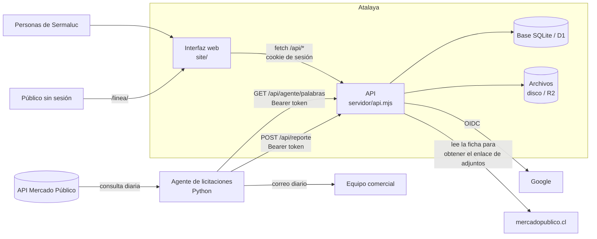

# 01 · Arquitectura

## Visión general



- **El agente** (carpeta `agente/`) consulta cada día hábil la API de Mercado Público, puntúa las licitaciones con las palabras clave que descarga de Atalaya, envía el correo y publica el reporte en Atalaya.
- **La API** recibe el reporte, lo normaliza en el modelo relacional y conserva el trabajo del equipo (estado, responsable, documentos, notas) aunque la licitación vuelva a llegar.
- **La interfaz** muestra radar, listado, ficha, tablero, equipo y configuración. Se actualiza sola cada 15 segundos si alguien cambió algo.
- **La línea de tiempo pública** (`/linea/`) muestra la "carrera" de licitaciones sin necesidad de ingresar, sin correos ni montos.

## Un mismo núcleo, dos formas de ejecución

Toda la lógica vive en `servidor/api.mjs`, que expone `handle(request, env)`: recibe una `Request` web estándar y devuelve una `Response`. Lo que cambia entre plataformas es solo quién le entrega la base de datos (`env.DB`) y el almacén de archivos (`env.FILES`).

| | Cloudflare (actual) | Servidor propio (Sermaluc) |
|---|---|---|
| Punto de entrada | `servidor/worker.mjs` | `servidor/server.mjs` |
| Base de datos | D1 `atalaya-sermaluc` | `servidor/db-sqlite.mjs` (SQLite de Node, archivo `atalaya.db`) |
| Archivos | R2 `atalaya-sermaluc-archivos` | `servidor/archivos-disco.mjs` (carpeta `archivos/`) |
| Archivos estáticos | Cloudflare Assets (`site/`) con cabeceras de `site/_headers` | `server.mjs` sirve `site/` con ETag y cabeceras de seguridad |
| HTTPS | Cloudflare | Caddy (certificado automático Let's Encrypt) o el balanceador de la nube |
| Configuración | `wrangler.toml` + secretos de Wrangler | `instalacion/.env` |
| Agente programado | GitHub Actions (disparado por un Worker "disparador") | GitHub Actions apuntando al nuevo dominio, o el servicio `agente` de Docker Compose |

`db-sqlite.mjs` imita la interfaz de D1 (`prepare().bind().first()/all()/run()` y `batch()`), y `archivos-disco.mjs` imita la de R2 (`put/get/delete`). Por eso el código de la API es idéntico en ambos casos y las pruebas automáticas cubren los dos.

## Estructura del repositorio

```
site/                       Interfaz web (sin compilación)
  index.html                Página única; carga styles.css, tema.js y app.js con ?v=N (control de caché)
  app.js                    Aplicación (enrutador por hash, vistas, llamadas a la API)
  styles.css                Estilos, tokens de color, modo oscuro, diseño responsivo
  tema.js                   Aplica el tema claro/oscuro antes de pintar (sin scripts en línea, por la CSP)
  linea/                    Línea de tiempo pública ("carrera de licitaciones")
  assets/                   Logos e íconos
  _headers                  Cabeceras de seguridad y caché para Cloudflare
servidor/
  api.mjs                   API completa (rutas, reglas de negocio, seguridad, auditoría)
  schema.sql                Esquema de la base (CREATE ... IF NOT EXISTS; se aplica al iniciar)
  migraciones/              Migraciones aplicadas a bases existentes (002, 003)
  worker.mjs                Entrada para Cloudflare Workers
  server.mjs                Servidor HTTP de Node para el servidor propio
  db-sqlite.mjs             Adaptador SQLite con interfaz D1
  archivos-disco.mjs        Almacén de archivos en disco con interfaz R2
  pruebas.mjs               Pruebas automáticas (npm test)
scripts/
  enviar-reporte.mjs        Envía un reporte JSON a Atalaya (uso manual o desde el agente)
  exportar-desde-cloudflare.mjs   Exporta la base D1 y los archivos R2
  crear-base.mjs            Crea la base SQLite y carga los datos exportados
  generar-secretos.mjs      Genera instalacion/.env con secretos nuevos
  respaldar.mjs             Respaldo en caliente de base y archivos
agente/                     Agente de licitaciones en Python (consulta, Excel, correo, publicación) y su disparador
.github/workflows/          Flujo diario del agente y pruebas automáticas
instalacion/                Paquete de instalación en servidores de Sermaluc (Docker Compose, Caddy, plantillas .env)
Dockerfile                  Imagen de Atalaya (Node 24, usuario sin privilegios)
data/demo.json              Datos de demostración (DEMO=1)
docs/                       Esta documentación
presentacion/               Presentación ejecutiva
wrangler.toml               Configuración de Cloudflare
```

## Flujo de una petición

1. El navegador pide `/api/...` con la cookie `atalaya_sesion`.
2. `handle()` crea un registro de auditoría en memoria para la petición y llama a `rutear()`.
3. `rutear()` aplica el esquema la primera vez (`ensureReady`), atiende las rutas públicas, las del agente (token), luego verifica CSRF y la sesión, y despacha a la función de cada ruta.
4. Las consultas se agrupan con `batch()` cuando es posible (un solo viaje a la base).
5. Las escrituras incrementan una versión global (`kv.version`); los navegadores consultan `/api/version` cada 15 s y recargan los datos solo si cambió.
6. Al terminar, `handle()` guarda en `auditoria` la frase legible y el detalle técnico (método, ruta, estado, IP, navegador, duración).

## Rendimiento en Cloudflare

D1 está en el este de EE.UU. La API corre junto a la base (`[placement] region = "aws:us-east-1"`) y solo `/api/*` pasa por el Worker (`run_worker_first`); HTML, CSS y JS salen del borde más cercano al usuario. En el servidor propio la base es un archivo local, por lo que la latencia de la base es despreciable.
