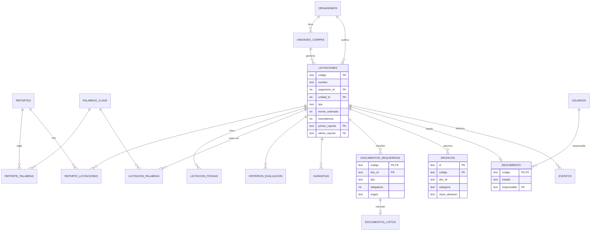

# 02 · Modelo de datos

La base de datos es **relacional** (SQLite: Cloudflare D1 en la instalación actual y un archivo `atalaya.db` en el servidor propio). Tiene 21 tablas. El esquema completo está en [`servidor/schema.sql`](../servidor/schema.sql). Las claves foráneas están activas: D1 las aplica por defecto y el servidor local las activa con `PRAGMA foreign_keys`.

## Diagrama

## Tablas

| Tabla | Qué guarda | Claves |
|---|---|---|
| `usuarios` | Equipo comercial: rol y contraseña (PBKDF2). | PK `email` |
| `reportes` | Cada envío del agente: cuándo se generó y cuántas licitaciones revisó. | PK `id` (fecha de recepción) |
| `palabras_clave` | Catálogo de palabras clave. | PK `palabra` |
| `reporte_palabras` | Palabras que vigilaba el agente en cada reporte. | PK (`reporte_id`, `palabra`) |
| `organismos` | Organismos compradores. | PK `id`, únicos `nombre` y `codigo` |
| `unidades_compra` | Unidades de compra de cada organismo, con su región. | PK `id`, único (`organismo_id`, `nombre`) |
| `licitaciones` | Datos de cada licitación. | PK `codigo`; FK a organismo, unidad y reportes |
| `reporte_licitaciones` | Qué licitaciones trajo cada reporte (historial). | PK (`reporte_id`, `codigo`) |
| `licitacion_fechas` | Hitos: publicación, preguntas, respuestas, cierre, aperturas, adjudicación. | PK (`codigo`, `hito`) |
| `licitacion_palabras` | Palabras clave con que calzó cada licitación. | PK (`codigo`, `palabra`) |
| `criterios_evaluacion`, `garantias` | Detalle de las bases, cuando se conoce. | PK (`codigo`, `orden`) |
| `documentos_requeridos` | Checklist de documentos a presentar. `origen` indica si lo creó el agente o el equipo. | PK (`codigo`, `doc_id`) |
| `documentos_listos` | Documentos del checklist marcados como listos. | PK y FK compuesta (`codigo`, `doc_id`) |
| `archivos` | Archivos subidos: bases y anexos, o documentos preparados (asociados a un ítem del checklist). El contenido vive en R2. | PK `id`; FK `codigo` |
| `seguimiento` | Estado de trabajo y responsable. | PK/FK `codigo`; FK `responsable` → `usuarios` (queda en NULL si se quita a la persona) |
| `eventos` | Bitácora: notas y cambios automáticos. | PK `id`; FK `codigo` |
| `palabras_vigiladas` | Palabras clave que usa el agente: peso positivo (suma) o negativo (resta), activa o pausada, y quién la creó. | PK `palabra` |
| `auditoria` | Registro de actividad: fecha, usuario, acción, frase legible, licitación relacionada, resultado (ok/error) y detalle técnico en JSON. Sin claves foráneas, para que sobreviva aunque se borren personas o licitaciones. | PK `id`; índices por fecha y usuario |
| `kv`, `limites` | Técnicas: contador de cambios y límite de intentos. | — |

## Reglas de integridad

- Si se borra una licitación, se borran en cascada sus fechas, palabras, checklist, archivos, seguimiento y bitácora.
- Los campos `estado`, `tipo` de documento, `origen`, `categoria` y `rol` solo aceptan valores válidos (restricciones `CHECK`).
- `documentos_listos.por` y `eventos.autor` guardan el correo como texto, sin clave foránea, para que el historial conserve quién hizo cada cosa aunque esa persona deje el equipo.
- Cuando llega un reporte nuevo, el agente actualiza los datos de la licitación sin tocar el trabajo del equipo: seguimiento, documentos marcados, archivos, bitácora y documentos agregados a mano. Un documento del agente que ya no viene solo se quita si nadie lo había marcado como listo.

## Migraciones

- `servidor/migraciones/002-modelo-relacional.sql` pasa del esquema anterior, con licitaciones guardadas como JSON, a este modelo, conservando todos los datos. Se aplicó en producción el 06-11-2026, después de respaldar la base.
- `servidor/migraciones/003-configuracion-y-auditoria.sql` crea `palabras_vigiladas` (con las 54 palabras que traía el agente) y `auditoria`. Se aplicó en producción el 06-11-2026.
