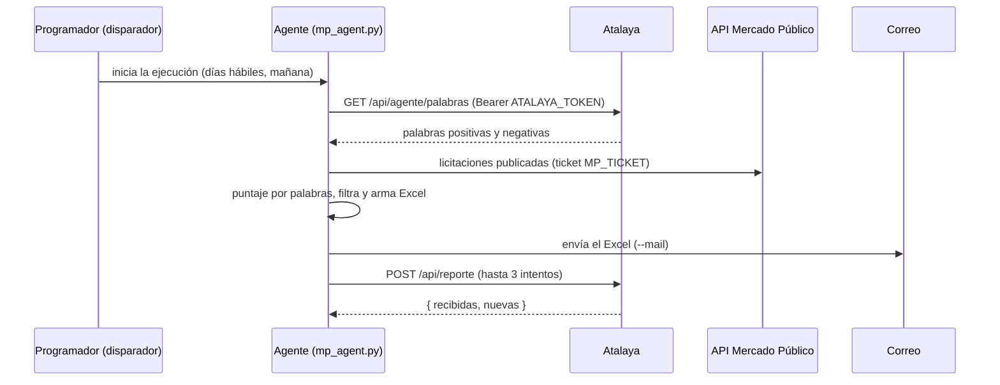

# 06 · Integración con el agente de licitaciones

El agente es un programa en Python que vive en la carpeta [`agente/`](../agente) de este mismo repositorio (antes estaba en el repositorio `taniabastias-ctrl/licitaciones-mp`, cuyo historial se conservó). Atalaya no consulta Mercado Público por su cuenta: recibe lo que el agente publica.

| Ruta | Contenido |
|---|---|
| `agente/mp_agent.py` | Consulta la API, puntúa, arma el Excel y orquesta la ejecución. |
| `agente/atalaya.py` | Descarga las palabras clave y publica el reporte en Atalaya. |
| `agente/enviar_correo.py` | Envío del correo diario por SMTP. |
| `agente/tests/` | 43 pruebas (`pytest -q`). |
| `agente/disparador/` | Worker de Cloudflare que lanza el flujo a las 06:30 de Chile. |
| `.github/workflows/licitaciones.yml` | Flujo diario del agente en GitHub Actions. |
| `.github/workflows/pruebas.yml` | Pruebas de la plataforma y del agente en cada cambio. |

## Ciclo diario



- Comando: `python mp_agent.py --dias 1 --min-score 3 --out licitaciones_AAAAMMDD.xlsx --mail --atalaya`.
- `--atalaya` hace dos cosas: usa las palabras clave configuradas en Atalaya (si Atalaya no responde, usa las de su código) y publica el reporte **en cada ejecución**, aunque no haya licitaciones nuevas.
- Si falta `ATALAYA_URL` o `ATALAYA_TOKEN`, el agente igual genera el Excel y envía el correo, pero termina con código de salida 1 para que la falla se note.
- `--palabras-locales` fuerza las palabras del código (sin consultar Atalaya).

## Variables del agente

| Variable | Uso |
|---|---|
| `MP_TICKET` | Ticket de la API de Mercado Público. |
| `ATALAYA_URL` | URL de Atalaya (hoy `https://atalaya-sermaluc.tania-bastias.workers.dev`; en el servidor propio `https://<dominio>` o `http://atalaya:8080` dentro de Docker). |
| `ATALAYA_TOKEN` | Igual a `AGENT_TOKEN` del servidor Atalaya. |
| `SMTP_HOST`, `SMTP_PORT`, `SMTP_USER`, `SMTP_PASSWORD`, `MAIL_FROM`, `MAIL_TO` | Envío del correo diario. |

## Dónde se programa hoy

- El flujo de GitHub Actions se ejecuta con `workflow_dispatch`; GitHub no es puntual con sus horarios programados.
- Lo dispara un Worker de Cloudflare ("disparador", `agente/disparador/`) a las 06:30 de Chile, días hábiles.
- `MP_TICKET`, `SMTP_*`, `MAIL_*`, `ATALAYA_URL` y `ATALAYA_TOKEN` son secretos del repositorio en GitHub.
- **Mientras no se haga el cambio de abajo, la ejecución diaria sigue corriendo desde el repositorio anterior `licitaciones-mp`**, que tiene los secretos cargados.

## Pasar la ejecución diaria a este repositorio

1. En GitHub, repositorio `atalaya` → Settings → Secrets and variables → Actions: cree los mismos secretos que tiene `licitaciones-mp` (`MP_TICKET`, `SMTP_HOST`, `SMTP_PORT`, `SMTP_USER`, `SMTP_PASSWORD`, `MAIL_TO`, `MAIL_FROM`, `ATALAYA_TOKEN` y, si se usa, `ATALAYA_URL`). GitHub no permite leer ni copiar secretos: hay que ingresarlos de nuevo.
2. Edite el token fino de GitHub que usa el disparador para que tenga acceso al repositorio `atalaya` (Actions: Read and write), o cree uno nuevo y cárguelo con `npx wrangler secret put GITHUB_TOKEN` en `agente/disparador`.
3. Para no repetir en el correo licitaciones ya enviadas, actualice `agente/vistos_inicial.json` con el `vistos.json` más reciente (la caché de Actions no se traspasa entre repositorios).
4. Lance a mano el flujo "Licitaciones TI diarias" desde la pestaña Actions de `atalaya` y revise el correo y Atalaya.
5. Publique el disparador (`cd agente/disparador && npx wrangler deploy`): ahora lanza el flujo de `atalaya` (`GITHUB_REPO` en `wrangler.toml`).
6. Archive el repositorio `licitaciones-mp` (Settings → Archive) para que quede solo como historial.

**Importante para desacoplarse de Cloudflare:** el disparador también vive en Cloudflare. Al migrar hay que elegir otro programador (ver [instalación, paso 7](07-instalacion-servidor-propio.md#paso-7--agente-de-licitaciones)): el servicio `agente` incluido en Docker Compose, un `cron` del servidor o un `schedule` de GitHub Actions.

## Formato del reporte (`POST /api/reporte`)

```json
{
  "meta": { "generado": "2026-11-06T08:00", "revisadas": 342, "fuente": "API Mercado Público",
            "agente": "mp_agent", "palabrasClave": ["mesa de ayuda", "ciberseguridad"] },
  "licitaciones": [{
    "codigo": "1509-45-LP26", "nombre": "…", "organismo": "…", "organismoCodigo": "…", "unidad": "…", "region": "…",
    "tipo": "LP", "montoEstimado": 480000000, "duracion": "36 meses", "publicada": "2026-10-20T09:00",
    "match": 96, "palabrasClave": ["mesa de ayuda"], "descripcion": "…",
    "fechas": { "publicacion": "…", "visitaTerreno": "…", "finPreguntas": "…", "respuestas": "…",
                "cierre": "2026-11-08T15:00", "aperturaTecnica": "…", "aperturaEconomica": "…", "adjudicacion": "…" },
    "documentos": [{ "id": "d1", "nombre": "Anexo N°1 · Identificación del oferente", "tipo": "Administrativo", "obligatorio": true }],
    "criterios": [{ "nombre": "Precio", "peso": 35 }],
    "garantias": [{ "tipo": "Seriedad de la oferta", "monto": "$ 5.000.000", "vigencia": "90 días" }],
    "contacto": { "nombre": "…", "email": "…" }
  }]
}
```

- Obligatorios por licitación: `codigo`, `nombre`, `fechas.cierre` y `documentos` (puede ser `[]`).
- Fechas en hora de Chile, formato `AAAA-MM-DDTHH:MM`.
- Máximo 2000 licitaciones y 10 MB por reporte.

## Reglas de carga

- Cada reporte queda en `reportes` con sus palabras (`reporte_palabras`) y sus licitaciones (`reporte_licitaciones`).
- Una licitación que llega por primera vez queda **NUEVA** con estado `nueva`.
- Si vuelve a llegar, se actualizan sus datos (nombre, fechas, montos, criterios, documentos informados por el agente), pero **se conservan** estado, responsable, documentos marcados, archivos, notas y los ítems del checklist agregados por el equipo.
- Organismos y unidades de compra se normalizan en sus propias tablas.

## Envío manual

```bash
AGENT_TOKEN=... ATALAYA_URL=https://atalaya.sermaluc.cl node scripts/enviar-reporte.mjs reporte.json
```
