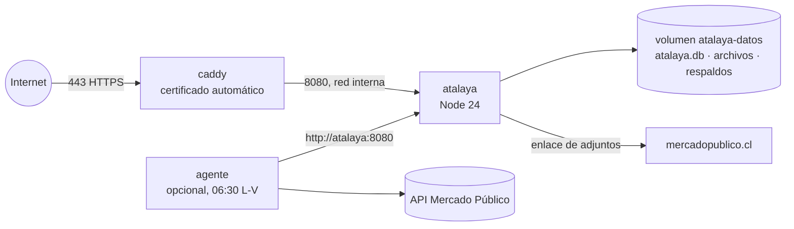

# 07 · Instalación en los servidores de Sermaluc

Esta guía deja Atalaya funcionando en un servidor de la nube de Sermaluc, con **toda la información que hoy está en Cloudflare** y **sin ninguna dependencia de Cloudflare** (ni base de datos, ni archivos, ni secretos, ni programador del agente).

## Qué se instala



| Componente | Archivo | Descripción |
|---|---|---|
| Imagen de Atalaya | `Dockerfile` | Node 24 (SQLite incluido), usuario sin privilegios, datos en `/data`, chequeo de salud en `/healthz`, zona horaria de Chile. |
| Orquestación | `instalacion/docker-compose.yml` | Servicios `atalaya`, `caddy` y `agente` (opcional, perfil `agente`). |
| Proxy HTTPS | `instalacion/Caddyfile` | Certificado Let's Encrypt automático, HSTS, compresión, límite de 30 MB. |
| Configuración | `instalacion/.env.example`, `instalacion/agente.env.example` | Plantillas de variables. |
| Scripts | `scripts/exportar-desde-cloudflare.mjs`, `scripts/crear-base.mjs`, `scripts/generar-secretos.mjs`, `scripts/respaldar.mjs` | Exportar, crear la base, generar secretos y respaldar. |

## Requisitos del servidor

- Linux de 64 bits (por ejemplo Ubuntu 24.04) con **Docker Engine 24+** y el plugin **Docker Compose v2**.
- 1 vCPU, 1 GB de RAM y 10 GB de disco son suficientes (la base pesa menos de 1 MB hoy; los archivos subidos son lo que más crece).
- Un nombre DNS (por ejemplo `atalaya.sermaluc.cl`) con registro A/AAAA apuntando a la IP pública del servidor.
- Puertos **80 y 443** abiertos desde internet (80 solo lo usa Caddy para el certificado y redirigir a HTTPS).
- Salida a internet hacia `www.mercadopublico.cl` (botón de adjuntos), `oauth2.googleapis.com` y `www.googleapis.com` (ingreso con Google) y, si se usa el agente en el servidor, `api.mercadopublico.cl` y el servidor SMTP.

> Si Sermaluc usa un balanceador o un proxy corporativo con su propio certificado, se puede omitir Caddy: publique el puerto 8080 del servicio `atalaya` solo hacia ese balanceador y configure que envíe `X-Forwarded-Proto: https` y `X-Forwarded-For`.

## Paso 1 · Exportar los datos desde Cloudflare (una vez, en el computador con acceso a Cloudflare)

En la carpeta de Atalaya, con sesión iniciada en Wrangler:

```bash
node scripts/exportar-desde-cloudflare.mjs
```

Genera `instalacion/datos/atalaya-datos.sql` (todas las filas de todas las tablas de la base D1) e `instalacion/datos/archivos/` (todos los archivos subidos a R2 con sus metadatos).

> La exportación contiene **datos personales y hashes de contraseñas**. Trasládela solo por un canal seguro (por ejemplo `scp` al servidor) y bórrela del computador cuando la instalación esté lista.

Para no perder cambios, haga la exportación definitiva **justo antes del cambio** (paso 8) y avise al equipo que no use Atalaya durante esos minutos.

## Paso 2 · Copiar Atalaya al servidor

Copie la carpeta del proyecto (sin `node_modules`, `.wrangler`, `respaldos` ni `.secretos-produccion.json`) al servidor, por ejemplo en `/opt/atalaya`, incluyendo `instalacion/datos/`:

```bash
rsync -av --exclude node_modules --exclude .wrangler --exclude respaldos --exclude .secretos-produccion.json ./ usuario@servidor:/opt/atalaya/
```

## Paso 3 · Configuración y secretos nuevos

En el servidor (`/opt/atalaya`). Si el servidor no tiene Node instalado, use el mismo contenedor de Node que trae Docker:

```bash
docker run --rm -v "$PWD":/app -w /app node:24-slim node scripts/generar-secretos.mjs atalaya.sermaluc.cl
```

Crea `instalacion/.env` con `DOMINIO`, un `SESSION_SECRET` nuevo y un `AGENT_TOKEN` nuevo, y **muestra el `AGENT_TOKEN` una sola vez**: guárdelo en el gestor de contraseñas de Sermaluc, porque el agente lo necesita. Luego revise `instalacion/.env`:

| Variable | Valor |
|---|---|
| `DOMINIO` | Dominio público, por ejemplo `atalaya.sermaluc.cl`. |
| `SESSION_SECRET` | Generado. No reutilice el de Cloudflare. |
| `AGENT_TOKEN` | Generado. Igual a `ATALAYA_TOKEN` del agente. |
| `ADMIN_EMAILS` | `tania.bastias@sermaluc.cl` (separe con comas si son varios). |
| `ALLOWED_DOMAIN` | `sermaluc.cl` |
| `GOOGLE_CLIENT_ID`, `GOOGLE_CLIENT_SECRET` | Ver paso 6 (opcional, recomendado). |
| `LOG` | `1` para registrar cada petición en la consola. |

Proteja el archivo: `chmod 600 instalacion/.env`.

## Paso 4 · Crear la base con los datos de Cloudflare

```bash
cd /opt/atalaya/instalacion
docker compose build
docker compose run --rm atalaya node scripts/crear-base.mjs --db /data/atalaya.db --datos /importar/atalaya-datos.sql --archivos /importar/archivos --reemplazar
```

El script:

1. Crea la base SQLite con `servidor/schema.sql` (las 21 tablas, índices y restricciones).
2. Carga todas las filas exportadas en una sola transacción (si algo falla, no deja nada a medias).
3. Descarta los contadores de intentos (`limites`), que no se migran.
4. Verifica la integridad de la base y que no existan referencias rotas entre tablas.
5. Copia los archivos a `/data/archivos` y avisa si falta alguno.
6. Muestra un resumen con la cantidad de filas por tabla. Compárelo con lo que se ve hoy en Atalaya.

Para una instalación **sin datos** (desde cero), omita `--datos` y `--archivos`.

## Paso 5 · Levantar Atalaya

```bash
docker compose up -d
docker compose ps
docker compose logs -f atalaya
```

Caddy obtiene el certificado en el primer acceso. Compruebe:

```bash
curl -s https://atalaya.sermaluc.cl/healthz        # ok
curl -s https://atalaya.sermaluc.cl/api/salud      # {"ok":true}
```

Ingrese con su cuenta. **Las contraseñas se migran**, así que cada persona entra con la misma contraseña que usaba en Cloudflare. Las sesiones abiertas no se migran (el secreto de sesión es nuevo): todos deben ingresar de nuevo una vez.

## Paso 6 · Ingreso con Google (recomendado)

En Google Cloud Console de Sermaluc (pantalla de consentimiento tipo **Interno**), cree o edite el cliente OAuth "Aplicación web" y agregue el URI de redireccionamiento:

```
https://atalaya.sermaluc.cl/api/auth/google/callback
```

Copie el ID y el secreto en `instalacion/.env` (`GOOGLE_CLIENT_ID`, `GOOGLE_CLIENT_SECRET`) y aplique:

```bash
docker compose up -d
```

## Paso 7 · Agente de licitaciones

El programador actual del agente es un Worker de Cloudflare ("disparador"), así que para quedar sin Cloudflare elija **una** de estas opciones:

**A. Agente dentro del servidor (recomendado para desacoplarse por completo).** El código ya viene en la carpeta `agente/` del repositorio:

```bash
cd /opt/atalaya/instalacion
cp agente.env.example agente.env && chmod 600 agente.env     # complete MP_TICKET, ATALAYA_TOKEN (= AGENT_TOKEN), SMTP_* y MAIL_*
docker compose --profile agente up -d --build
docker compose logs -f agente                                  # muestra "Próxima ejecución: ..."
```

Corre de lunes a viernes a las 06:30 (hora de Chile) y publica en Atalaya por la red interna de Docker. Para probarlo de inmediato:

```bash
docker compose run --rm agente python mp_agent.py --dias 1 --min-score 3 --out /trabajo/prueba.xlsx --vistos /trabajo/vistos.json --atalaya
```

Luego deshabilite el flujo de GitHub Actions y el Worker "disparador" para que no corra dos veces.

**B. Seguir usando GitHub Actions.** En el repositorio `atalaya` (flujo `.github/workflows/licitaciones.yml`), actualice los secretos `ATALAYA_URL` (`https://atalaya.sermaluc.cl`) y `ATALAYA_TOKEN` (el `AGENT_TOKEN` nuevo), y reemplace el disparador de Cloudflare por un `schedule` de GitHub Actions (por ejemplo `cron: "30 9 * * 1-5"`, que en UTC equivale a las 06:30 de Chile en horario de verano).

## Paso 8 · Cambio definitivo y desconexión de Cloudflare

1. Avise al equipo y espere a que nadie esté trabajando en Atalaya.
2. Repita el paso 1 (exportación final), copie `instalacion/datos/` al servidor y repita el paso 4 con `--reemplazar`; luego `docker compose restart atalaya`.
3. Verifique en el nuevo dominio: cantidad de licitaciones, estados, responsables, archivos y registro de actividad.
4. Comunique la nueva dirección al equipo.
5. En Cloudflare (cuando ya esté conforme): elimine el Worker `atalaya-sermaluc`, la base D1 `atalaya-sermaluc`, el bucket R2 `atalaya-sermaluc-archivos` y el Worker "disparador". Antes, guarde una última exportación como respaldo.
6. Borre `instalacion/datos/` del computador de origen y del servidor.

## Variables del contenedor `atalaya`

| Variable | Por defecto | Uso |
|---|---|---|
| `PORT` | `8080` | Puerto interno. |
| `DB_PATH` | `/data/atalaya.db` | Archivo de la base. |
| `FILES_PATH` | `/data/archivos` | Carpeta de archivos subidos. |
| `SESSION_SECRET` | — | Obligatorio (32+ caracteres). |
| `AGENT_TOKEN` | — | Obligatorio para el agente (24+ caracteres). |
| `ADMIN_EMAILS` | — | Cuentas de administración. |
| `ALLOWED_DOMAIN` | `sermaluc.cl` | Dominio permitido. |
| `GOOGLE_CLIENT_ID`, `GOOGLE_CLIENT_SECRET` | — | Ingreso con Google. |
| `DEMO` | `0` | `1` carga datos de ejemplo si la base está vacía (solo pruebas). |
| `LOG` | `1` | `0` desactiva el registro de peticiones en la consola. |
| `TZ` | `America/Santiago` | Zona horaria. |

## Instalación sin Docker (alternativa)

Requiere Node.js 24 (o 22.5+).

```bash
cp .env.example .env               # complete SESSION_SECRET, AGENT_TOKEN, ADMIN_EMAILS y DB_PATH
node scripts/crear-base.mjs --db /var/lib/atalaya/atalaya.db --datos instalacion/datos/atalaya-datos.sql --archivos instalacion/datos/archivos
node --disable-warning=ExperimentalWarning servidor/server.mjs
```

Ejecútelo como servicio (`systemd`) con un usuario sin privilegios y detrás de un proxy HTTPS (nginx, Caddy o el balanceador de la nube).
